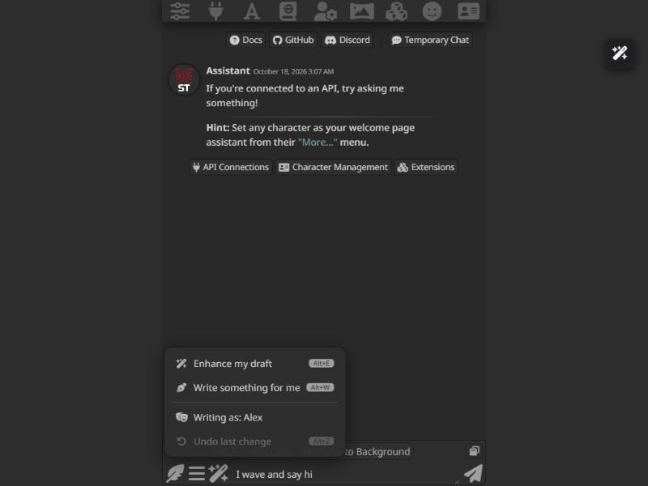
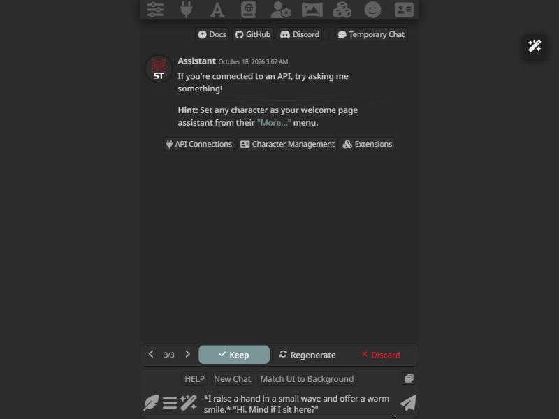

<p align="center"></p>

<p align="center">
Janitor AI's <b>Enhance my draft</b> and <b>Write something for me</b>, for SillyTavern.<br>
Type a rough line, get a finished message. It follows your preset, and you stay in control of what gets sent.
</p>

<p align="center">
<a href="LICENSE"></a>
<a href="https://github.com/brabro1/Draft-Enhancer/releases"></a>

<a href="https://github.com/brabro1/Draft-Enhancer/issues"></a>
</p>

> **Beta.** It works, but expect changes between versions. Bug reports and ideas are very welcome in the [issues](https://github.com/brabro1/Draft-Enhancer/issues).

## What it does

| You type | You get |
| --- | --- |
| `I wave and say hi` + **Enhance my draft** | A full message: *I raise a hand in a small wave and offer a warm smile. "Hi. Mind if I sit here?"* |
| *(nothing)* + **Write something for me** | The next message, written for you in your voice |
| `ask about the key (curious, not accusing)` + **Write something for me** | A message that asks about the key, using the bracket as a direction |

<p align="center">


</p>

The result always lands in your message box. Edit it, regenerate it, or throw it away, then send when you are happy.

## Features

- **Three actions**: enhance a draft (or just the part you selected), have the next message written for you, or let it finish a draft you started.
- **Refine** any result in one tap: shorter, longer, more dialogue, more detail, more emotion, simpler wording, or a change you type yourself.
- **Follows your preset**: main prompt, jailbreak, lorebooks, persona and chat history all apply, because it runs through SillyTavern's Impersonate.
- **Write as** yourself, the character (or any member of a group chat), or the narrator, remembered per character.
- **Sounds like you**: optional voice matching from your recent messages, plus tone, point of view, formatting, language and length controls.
- **Keep / Regenerate / Refine / Discard** bar, with a history of earlier results you can flip back to, and multi-step Undo.
- **Works with any model and preset**: clean text while it streams (no reasoning or trackers flashing in the box), a compact instruction style for small or local models, retries on empty results, and clean-up of reasoning blocks, headers, trackers and chatty lead-ins.
- **Draft with another model**: pick a Connection Manager profile for drafting; your connection is switched back afterwards.
- **Everywhere**: feather button, wand menu, keyboard shortcuts and slash commands. Works on phone and desktop.
- **Private**: no network requests of its own.

## Quick start

1. Install it (below), reload SillyTavern and open a chat.
2. Type a few words in the message box.
3. Tap the feather button and pick **Enhance my draft** (or press `Alt+E`).
4. Press **Keep** to edit and send, **Regenerate** for another take, or **Discard** to get your draft back.

## Contents

- [Installation](#installation)
- [How to use](#how-to-use)
- [How it follows your preset](#how-it-follows-your-preset)
- [Settings](#settings)
- [Troubleshooting](#troubleshooting)
- [FAQ](#faq)
- [Limitations](#limitations)
- [Privacy](#privacy)
- [Updating](#updating)
- [Contributing](#contributing)
- [For developers](#for-developers)
- [License](#license)

## Installation

**From GitHub (recommended)**

1. In SillyTavern open **Extensions** (puzzle-piece icon) and click **Install extension**.
2. Paste `https://github.com/brabro1/Draft-Enhancer` and confirm.
3. Reload the page. A feather button appears in the send bar.

Installing from a URL needs `git` on the machine that runs SillyTavern (on Termux: `pkg install git`).

**Manually**

Copy the extension folder (the one with `manifest.json` inside) to `SillyTavern/data/<your-user>/extensions/` and restart SillyTavern.

**On a phone**

- If your phone opens SillyTavern that runs on your PC or a server, there is nothing to do: install it there once and it shows up on every device.
- If SillyTavern runs on the phone itself (Termux):

  ```bash
  cd ~/SillyTavern/data/default-user/extensions
  git clone https://github.com/brabro1/Draft-Enhancer
  ```

  Then restart SillyTavern.

After an update, close and reopen the browser tab so the phone does not keep the old version cached.

## How to use

1. Type something in the message box.
2. Tap the feather button and pick an action:

| Menu item | What it does | Shortcut |
| --- | --- | --- |
| Enhance my draft | Rewrites the text in the box into a finished message. **Select part of the text first** to rewrite only that part; the rest stays exactly as it is. | `Alt+E` |
| Write something for me | Writes the next message; the text in the box (if any) is the direction | `Alt+W` |
| Continue my draft | Keeps what you wrote and adds the rest, from exactly where you stopped (even mid-sentence) | `Alt+C` |
| Writing as: *name* | Switches between **you**, **the character** (each member in a group chat) and **the narrator**. Remembered per character and group. | |
| Undo last change | Brings back the text you had before; press again to go further back | `Alt+Z` |

The menu is a small popup above the button that fades in and out exactly like SillyTavern's own options and wand menus, and it follows SillyTavern's reduced-motion setting. Tapping anywhere outside it closes it.

The result appears in the message box and streams in live, already cleaned: reasoning, trackers and status blocks never flash in the box (while a reasoning model is still thinking, the box says "Draft Enhancer is writing…"). Edit it if you like, then send. Tap the feather again while it is working to cancel; your draft comes back.

### After each result: Keep, Regenerate, Refine, Discard

A bar appears right above the message box, in the same place SillyTavern puts its own confirm bar:

| Button | What it does |
| --- | --- |
| **Keep** | Hides the bar and leaves the text in the box, ready to edit and send |
| **Regenerate** | Runs the same request again, with the same draft, direction and subject. Earlier results are kept: use the **‹ 2/3 ›** arrows to flip between them (last 8) |
| **Refine** | Changes the result in the box (including your own edits) in one way: **Shorter**, **Longer**, **More dialogue**, **More detail**, **More emotion**, **Simpler wording**, or type your own change ("make her sound colder") |
| **Discard** | Puts your original draft back and hides the bar (Undo brings the result back) |

The bar also disappears when you send the message or switch chats, and it can be turned off in the settings. Editing the text yourself keeps the bar open, so you can still regenerate or discard afterwards.

The actions are also in SillyTavern's **Extensions (wand) menu**, and as slash commands:

- `/enhance-draft [text]` (alias `/enhance`)
- `/write-for-me [direction]` (alias `/writeforme`)
- `/continue-draft [text]` (alias `/continuedraft`)

All take an optional `as=` argument for a single run: `user`, `char`, `narrator`, or a group member's name, e.g. `/write-for-me as=char she pours the tea`.

### Writing as

Your message does not have to be about you. The **Writing as** row in the menu (and the **Write as** setting) cycles between you, the character (in a group chat: each member) and the narrator, and remembers the choice per character and group; the result always goes into **your own message box** as your message:

| Write as | What the result contains |
| --- | --- |
| **You** | Your persona's own actions, words and thoughts. The character is left alone. |
| **The character** | The character's own turn: their point of view, voice, actions, words and thoughts. Nothing the player does, says or thinks is written; the character only reacts to what you already did in the chat. It is not a reply posted by the character; it is your message moving them. |
| **Narrator** | An outside storyteller. Depending on the moment it shows both you and the character acting and speaking in the scene (plus side characters), or it only narrates the setting, atmosphere and events. It decides from your direction and the recent messages. |

Both actions work with every subject. For example, set **Writing as: (character)**, type `she hands me the tea and smiles`, and **Enhance my draft** turns it into a full paragraph of the character doing that. Or leave the box empty and use **Write something for me**: in character mode the result sounds like the character, because their recent messages are used as the voice sample.

Presets usually tell the model to write only you and never as the character. For the character and narrator subjects, the task note lifts that rule for this one message, and keeps everything else from your preset. In character mode it also tells the model never to write your actions, words or thoughts.

When writing as you, a draft can still mention what the character does (`I take the cup she offers`). That stays as written and nothing more is added for them.

## How it follows your preset

Draft Enhancer does not use its own writing rules. It runs the request through SillyTavern's normal generation, so everything your preset sets up applies: main prompt, jailbreak, enabled toggles, post-history instructions, lorebooks, author's note, persona and chat history.

Every request, whatever you write as, goes through **Impersonate**: the same path as SillyTavern's Impersonate button. That means the preset's Impersonation prompt, its impersonation prefill, any prompts set to fire only on Impersonate, and your User Input regex scripts all apply, exactly as they do for a normal impersonation.

On top of that, the extension adds one short note as the very last message of the prompt (with Chat Completion APIs it is appended after everything the preset adds, so a tracker or chain-of-thought template placed at the end cannot outrank it; with other APIs it is injected at depth 0). When you write as the character or the narrator, the preset's own impersonation prompt ("write as you, never as the character") is left out of that one request, because it says the opposite of the task. The note says only what the preset cannot know:

- the task (enhance or write) and whose turn it is
- your draft or direction
- the rules you chose in the settings (faithfulness, point of view, formatting, language, length)
- your own notes

Everything the note does not mention — style, tone, vocabulary, content rules — comes from your preset.

Many presets add extras to every narrator reply, such as a time/location header, status or tracker panels, HTML or reasoning. The note asks the model to leave them out, and **Remove preset extras** cleans up anything that still comes through.

## Settings

Open **Extensions** and expand **Draft Enhancer**.

**General**

| Setting | Default | What it does |
| --- | --- | --- |
| Enabled | On | Shows or hides the button and the menu entries |
| Also show the actions in the wand menu | On | Adds the two actions to SillyTavern's Extensions menu |
| Keyboard shortcuts | On | `Alt+E`, `Alt+W`, `Alt+C`, `Alt+Z` inside the message box |
| Show Keep / Regenerate / Refine / Discard | On | The bar above the message box after each result (see above) |
| Send automatically | Off | Sends the result right away |
| Log every request | Off | Writes each note and raw model output to the browser console |

**Writing**

| Setting | Default | What it does |
| --- | --- | --- |
| Write as (default) | You | You, the character, or the narrator (see above), for characters you have not set in the menu |
| Remember "Write as" for each character and group | On | The menu's **Writing as** row is saved per character and per group chat |
| Length | Flexible | **Flexible** fits your text: a one-line draft grows into a full message (about 50-120 words), a short paragraph roughly doubles, a detailed draft is polished without padding. For Write it follows how long that side of the chat usually writes. **Short** (30-80), **Medium** (80-180), **Long** (180-350) and **Custom range** are fixed. Enhance never makes a draft shorter. |
| Custom minimum / maximum words | 60 / 160 | Used when Length is **Custom range** |
| Point of view | Auto | Auto follows the chat, or force first, second or third person |
| Formatting | Auto | Auto follows the chat, or force `*actions*` and `"dialogue"`, plain prose, or dialogue only |
| Language | Same as what I typed | The language of your text, the language of the chat, or one you name |
| Enhance: faithfulness | Balanced | **Strict**: only wording and detail change. **Balanced**: small supporting beats may be added. **Creative**: the draft is a skeleton to develop. |
| Tone | Auto | Auto follows the chat, or steer it: warm, romantic, playful, tense, dark, calm, angry |
| Match the writing voice | On | Sends a few recent messages from the side being written (yours, or that character's) as a style sample |
| Treat (parentheses) and [brackets] as directions | On | `I walk in (nervous, hesitant)` makes the model act on the bracket instead of writing it out |
| Continue exactly where the chat stopped | On | Repeats the last message of the chat right next to the task, so the new message follows directly from it (same scene, place and moment) even when the preset puts pages of instructions between the history and the end of the prompt |
| Do not repeat recent messages | On | Adds a rule against reusing recent wording |
| Stop where the other side would answer | On | Keeps the turn open instead of resolving the moment |

**Model compatibility**

| Setting | Default | What it does |
| --- | --- | --- |
| Connection profile for drafting | Same as chat | Drafts with another API or model from the Connection Manager, then switches back. For a safe switch back, your own connection must be a saved profile that is still up to date; otherwise Draft Enhancer warns and uses your current connection. |
| Instruction style | Full | **Compact** sends a much shorter note with only the essential rules. Use it with small or local models that lose track of long instructions |
| Skip the preset's end-of-reply extras | On | Adds a rule telling the model this is one message for the player: no tracker, status block, suggestions or notes, and no preset rule about who it may write for (roleplay / director / persona modes) |
| Clean the text live while it streams | On | Shows the reply cleaned while it streams in |
| Retries on an empty result | 1 | Automatically asks again (up to 3 times) when the model returns nothing usable |
| Enhance with an empty box writes for me | On | Instead of a warning, Enhance on an empty box acts like Write something for me |
| Cut a reply stopped mid-sentence | On | If the response limit cut the text off, it is trimmed back to the last full sentence (only when that keeps most of the text) |

**Instructions**

| Setting | Default | What it does |
| --- | --- | --- |
| Your notes for Enhance / for Write | empty | Free text added to that action's request |
| Custom instruction (advanced) | empty | Replaces the built-in note entirely. **Insert the built-in instruction** fills the box with the current one so you can edit it. Macros: `{{draft}}`, `{{direction}}`, `{{rules}}`, `{{notes}}`, `{{subject}}`, `{{other}}`, `{{min}}`, `{{max}}`, `{{last}}` (the last chat message), plus SillyTavern's own macros such as `{{user}}` and `{{char}}`. |

**Clean-up of the result**

| Setting | Default | What it does |
| --- | --- | --- |
| Remove reasoning blocks | On | `<think>`, `<thinking>`, `<checklist>` and similar |
| Remove scene headers | On | Lines such as `[ 08:15 PM \| Day 3 \| Tavern ]` |
| Remove status, tracker and internal-state panels | On | `<details>` blocks, `<tracker>` / `<svt>` / `<trk>` / `<bst>` tag trackers (with their content), plot-director and brainstormer blocks, `💰` one-line trackers, HTML comments |
| Remove any remaining HTML tags | On | Keeps the text inside them, drops the tags |
| Remove chatty lead-ins and trailing notes | On | Drops "Sure, here is the message:" lines and a trailing "Note: …" line that some models add |
| Also remove | empty | Your own regular expressions, one per line, as `/pattern/flags` or a bare pattern |

**Preview the note** (at the bottom of the panel) shows exactly what would be sent right now for the text in your box. **Reset everything to defaults** is next to it.

## Works with big toggle presets

Presets such as *Writer's Block Unlimited* switch on many things at once: narrative modes ("Roleplay: never write for the user", "Director: the user is not a character"), trackers that must end **every** reply, writing assistants (plot director, brainstormer), and chain-of-thought templates. Draft Enhancer is built to cope:

- The note tells the model this is one message for the player and to skip trackers, status blocks and suggestions (**Skip the preset's end-of-reply extras**), and that its own task overrides the preset's "who you may write for" rules.
- Anything that still comes through is removed: `<think>` blocks, `<details>` panels, tag trackers like `<svt>…</svt>`, `<trk>`, `<bst>`, and `<tracker>` wrappers, with their content.
- If a toggle of yours produces something else, add a pattern under **Also remove**, or turn on **Log every request** and open an [issue](https://github.com/brabro1/Draft-Enhancer/issues/new/choose) with the raw output.

## Troubleshooting

**The button does not appear.** Check that `manifest.json` is at the top level of the extension folder, restart SillyTavern and reload the page. Errors appear in the browser console with the prefix `[Draft Enhancer]`.

**The result does not sound like my preset.** Most of the style comes from your preset's **Impersonation prompt** (AI Response Configuration, Utility Prompts) and any prompts set to trigger on Impersonate. Adjust those, or use **Your notes**. For full control, write your own instruction in **Custom instruction**.

**A header or status panel ends up in my message.** Keep **Remove preset extras** on. If one still gets through, turn on **Log requests** and open an issue with the raw output.

**Empty result with a reasoning model.** The reasoning can use up the whole response length. Raise the response length in your preset.

**It adds things I did not write.** Set **Enhance: faithfulness** to **Strict**.

**It writes for the character when I only want my own message.** Check that **Write as** is **You** (the menu row shows the current one).

**Does it work in group chats?** Yes. "The character" is whoever SillyTavern currently treats as the active character.

## FAQ

**Does it work with my model or API?** Yes. It uses whatever connection SillyTavern already has, chat completion or text completion. If a small or local model ignores the instructions, set **Instruction style** to **Compact**.

**Will it post as the character?** No. The text always goes into your message box and nothing is sent until you send it (unless you turn on **Send automatically**).

**Can I change the instruction it sends?** Yes: add **Your notes**, or replace the whole instruction in **Custom instruction (advanced)**. Turn on **Log every request** to see exactly what is sent.

**Does it cost extra?** Each use is one normal generation on your API, like pressing Impersonate.

**Does it work in group chats?** Yes. "The character" is whoever SillyTavern currently treats as the active character.

## Limitations

- Beta: settings and behaviour may still change.
- Needs a recent SillyTavern release.
- One request at a time, and not while a normal reply is generating.
- Undo keeps the last 20 changes. Regenerate history keeps the last 8 results and is cleared by Discard, a new run or switching chats.
- Drafting with another connection profile switches SillyTavern's connection for the duration of the request.
- Every request is an impersonation as far as SillyTavern is concerned, so other extensions that react to Impersonate also see it.
- The quality depends on your model and preset.

## Privacy

Draft Enhancer makes no network requests of its own. Your text goes only to the API you already use in SillyTavern, the same way a normal message does. It stores only its settings, inside your SillyTavern settings.

## Updating

In SillyTavern open **Extensions**, click the update (circular arrow) icon next to Draft Enhancer, then reload the page. Or run `git pull` inside the extension folder. See the [changelog](CHANGELOG.md) and the [releases](https://github.com/brabro1/Draft-Enhancer/releases).

## Contributing

Bug reports, ideas and pull requests are welcome. For a bug, open an [issue](https://github.com/brabro1/Draft-Enhancer/issues/new/choose) with your SillyTavern version, API, model and preset, plus the console output with **Log every request** on (remove anything private).

## For developers

```
manifest.json   extension metadata
index.js        settings, the task note, generation, cleanup, menu, action bar, slash commands
style.css       button, menu, action bar and settings styles
tests/run.mjs   tests for the note and the clean-up (node tests/run.mjs; also run on every push)
```

Console helpers:

```js
DraftEnhancer.enhance('I wave');            // same as the menu item; resolves to the text or null
DraftEnhancer.write('ask about the key');
DraftEnhancer.write('she pours the tea', 'char'); // one run as a different subject
DraftEnhancer.continue('I open the door and');
DraftEnhancer.refine('Make it shorter.');  // changes the result in the box
DraftEnhancer.undo();
DraftEnhancer.previewNote();             // shows the note that would be sent
DraftEnhancer.getLastPrompt();            // the last note that was sent
DraftEnhancer.getLastOutput();            // the last raw model output
```

When reporting a bug, include your SillyTavern version, API and model, preset name, and the console output with **Log requests** on (remove anything private).

## License

[MIT](LICENSE)
